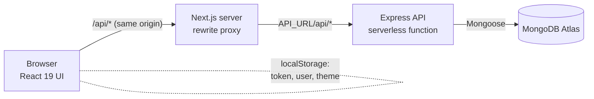
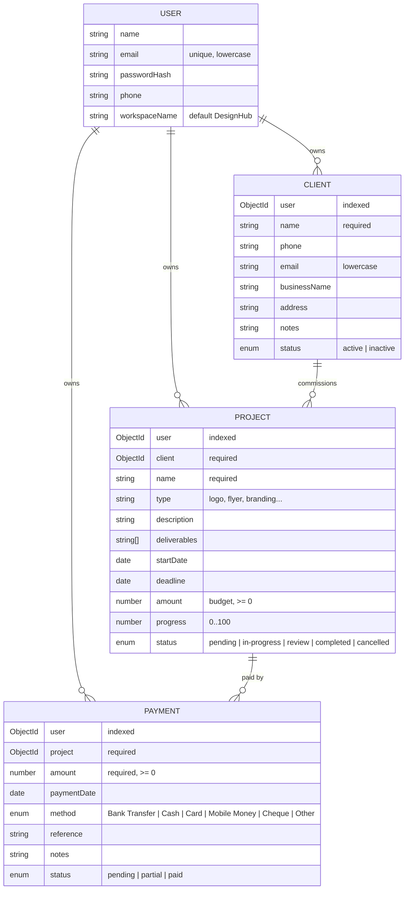
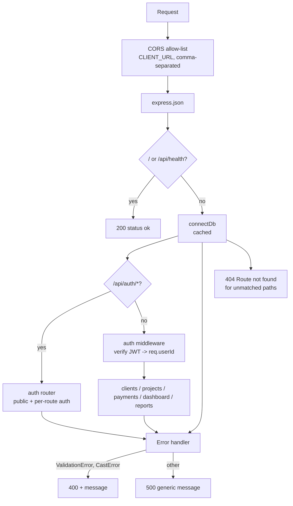
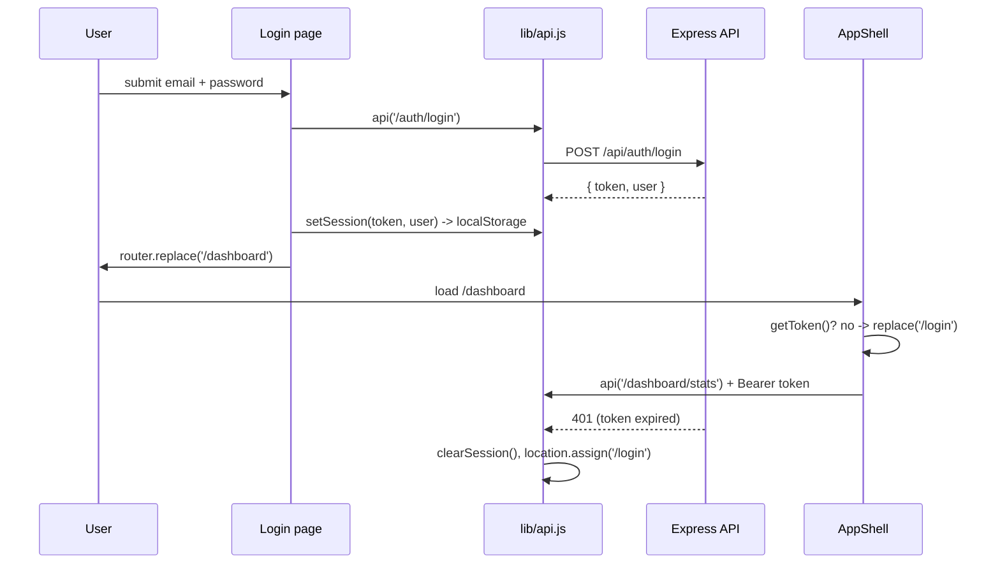
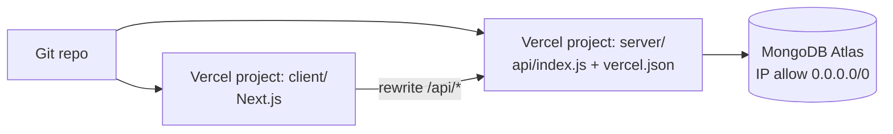

# DesignHub – System Design

DesignHub is a web application for freelance graphic designers to manage **clients**, **projects** and
**payments**, with a dashboard and reports on top. Each designer signs up for their own private workspace.

| | |
|---|---|
| Frontend | Next.js 16 (App Router), React 19, plain CSS (`globals.css`, `screens.css`) |
| Backend | Node.js, Express 5, REST + JSON |
| Database | MongoDB (Atlas) via Mongoose 9 |
| Auth | Email + password, bcrypt hashes, stateless JWT (7 days) |
| Hosting | Two Vercel projects: `client/` (Next.js) and `server/` (Express as a serverless function) |
| Currency | Nigerian naira (₦), whole-number display |

---

## 1. Architecture



**Key decisions**

1. **Same-origin API via a Next.js rewrite.** The browser only ever calls `/api/...` on the frontend's own
   domain; `next.config.mjs` forwards it to the backend URL held in the server-side `API_URL` variable.
   Benefits: no CORS in production, the backend URL is never shipped to the browser, and no `NEXT_PUBLIC_`
   variable is required. `NEXT_PUBLIC_API_URL` remains as an optional direct-call override
   (`client/lib/api.js`).
2. **The Express app is separate from the process that runs it.** `server/src/app.js` exports the app without
   calling `listen()` and without connecting to the database at import time. `src/index.js` (local/long-running)
   connects, then listens; `api/index.js` (Vercel) simply re-exports the app as a `(req, res)` handler. This
   also lets the tests drive the app with Supertest.
3. **Cached, lazy DB connection.** `src/db.js` stores the Mongoose connect-promise on `global`, so warm
   serverless invocations reuse one connection. A failed attempt clears the cache so the next request retries.
   `serverSelectionTimeoutMS` is 8 s (well inside Vercel's 30 s `maxDuration`) and `maxPoolSize` is 5 so many
   concurrent function instances do not exhaust Atlas connections. A middleware on `/api` awaits the
   connection before any route runs (except `/` and `/api/health`, which stay DB-free for liveness checks).
4. **Multi-tenancy by row ownership.** Every document carries a `user` reference. Every query is scoped with
   `user: req.userId`, taken from the verified JWT, never from request input.
5. **Stateless auth.** No server sessions; the client stores the JWT in `localStorage` and sends it as
   `Authorization: Bearer <token>`.

---

## 2. Data model



All collections use Mongoose `timestamps`. Only `user` is indexed besides `users.email` (unique).

### Business rules (the "money model")

| Rule | Where |
|---|---|
| **Received** = sum of payments whose status is **not** `pending`. | `server/src/lib/finance.js`, dashboard, reports |
| **Balance** of a project = `max(0, budget − received)`; overpayment never yields a negative balance. | `balanceOf`, projects/clients/payments routes |
| **Billed** (dashboard) = sum of budgets of non-cancelled projects. Cancelled projects are excluded from outstanding amounts. | `dashboard.js`, `clients.js` |
| Marking a project `completed` forces `progress = 100`. | `projects.js › pick` |
| A **project's client** and a **payment's project** must belong to the caller. | POST/PUT handlers |
| A payment **cannot be moved** to another project (the `project` field is dropped on update). | `payments.js › PUT` |
| A client **with projects cannot be deleted** (409). | `clients.js › DELETE` |
| Deleting a project **cascades** to its payments. | `projects.js › DELETE` |
| "Overdue" = deadline in the past and status not `completed`/`cancelled`. | `dashboard.js` |
| Emails are lower-cased on write and lookup. | models + auth routes |

---

## 3. Backend

### 3.1 Layout

```
server/
  api/index.js            Vercel entry: module.exports = app
  vercel.json             rewrites everything to /api, maxDuration 30s
  src/
    index.js              local entry: connect -> listen
    app.js                Express app, CORS, routing, error handling
    db.js                 cached Mongoose connection
    middleware/auth.js    JWT verification -> req.userId
    lib/finance.js        paidByProject(), balanceOf()
    models/               User, Client, Project, Payment
    routes/               auth, clients, projects, payments, dashboard, reports
    seedDemo.js           sample data for the demo account
  tests/                  Vitest + Supertest + in-memory MongoDB
```

### 3.2 Request pipeline



Error contract: every error is JSON `{ "message": string }`. Mongoose `ValidationError`/`CastError` (e.g. a
malformed id, an invalid enum) map to **400**; anything else is logged and returned as a generic **500** so
internals do not leak.

### 3.3 Authentication

- `POST /api/auth/register` – requires name, email, password (≥ 6 chars); 409 on duplicate email; hashes with
  bcrypt (cost 10); returns `{ token, user }`.
- `POST /api/auth/login` – identical 401 message for unknown email and wrong password (no user enumeration).
- `POST /api/auth/demo` – get-or-create a shared demo user (`demo@designhub.app`) with a random unusable
  password and seeded data; disabled with `ENABLE_DEMO=false`.
- `GET/PUT /api/auth/me`, `PUT /api/auth/password` – profile and password change (needs current password).
- Token: `jwt.sign({ id }, JWT_SECRET, { expiresIn: '7d' })`. `middleware/auth.js` accepts only
  `Authorization: Bearer …`; invalid/expired → 401.

### 3.4 API reference

All routes except `/api/auth/{register,login,demo}` and `/api/health` require a bearer token.
List endpoints are always filtered to the caller.

| Method & path | Purpose / notes |
|---|---|
| `GET /api/health` | Liveness, no auth, no DB |
| `POST /api/auth/register` · `login` · `demo` | Obtain `{ token, user }` |
| `GET /api/auth/me` · `PUT /api/auth/me` · `PUT /api/auth/password` | Profile |
| `GET /api/clients?search&status&page&limit` | Paginated `{ items, total, page, pages }`; each item has `projectCount`, `totalSpent`. `limit` ≤ 1000. Search is a case-insensitive, regex-escaped match over name/email/phone/business/address |
| `POST /api/clients` | `name` required |
| `GET /api/clients/:id` | Client + `projects[]` (with `amountPaid`) + `stats` (`totalProjects`, `activeProjects`, `completedProjects`, `totalPaid`, `outstanding`, `pendingInvoices`) |
| `PUT` / `DELETE /api/clients/:id` | DELETE → 409 if projects exist |
| `GET /api/projects?search&status&client` | Populated client, sorted by deadline |
| `POST /api/projects` | `name`, `client` required; `deliverables` may be an array or newline-separated string |
| `GET /api/projects/:id` | Project + `payments`, `totalPaid`, `balance` |
| `PUT` / `DELETE /api/projects/:id` | DELETE cascades to payments |
| `GET /api/payments?project&status` | Populated project → client, newest first |
| `GET /api/payments/summary` | `totalReceivedThisYear`, `pendingAmount`, `outstandingProjects`, `transactions` |
| `POST /api/payments` | `project`, `amount` required (0 allowed) |
| `GET` / `PUT` / `DELETE /api/payments/:id` | `project` immutable on PUT |
| `GET /api/dashboard/stats` | Counts, `projectsByStatus`, `totalBilled`, `totalReceived`, `outstanding`, `overdueProjects`, `upcomingDeadlines` (next 5) |
| `GET /api/reports/projects?from&to&status&client` | Rows with `amountPaid`/`balance` + totals; date filter on `createdAt` |
| `GET /api/reports/payments?from&to&status` | Rows + total; date filter on `paymentDate` |

**Write whitelisting.** Each router has a `FIELDS` list and a `pick()` helper, so clients cannot set `user`,
`_id`, timestamps or any unknown field (mass-assignment protection).

### 3.5 Configuration

| Variable | Purpose |
|---|---|
| `MONGODB_URI` | Atlas connection string (required) |
| `JWT_SECRET` | Token signing key (required; the connection helper refuses to start without it) |
| `CLIENT_URL` | Comma-separated allowed CORS origins; default `http://localhost:3000` |
| `PORT` | Local port (`.env.example` uses 5050) |
| `ENABLE_DEMO` | `false` disables `/api/auth/demo` |

### 3.6 Known limitations / improvement candidates

These are observations from reading the code, not bugs that block use:

- **Reports** compute `balance = amount − amountPaid` without clamping at 0, unlike every other endpoint, so an
  overpaid project shows a negative balance there. The paid-total aggregation is also duplicated instead of
  using `finance.paidByProject`.
- **Dashboard `outstanding`** is `billed − received`, where received includes payments on cancelled projects
  and overpayments, so it can differ from the sum of per-project balances shown on the Payments page.
- `GET /api/projects` and `GET /api/payments` are **not paginated**; the project form loads all projects.
- Only `user` is indexed on `clients/projects/payments`. Queries by `client` / `project` / `status` and
  sorting by `deadline`/`paymentDate` would benefit from compound indexes as data grows.
- No rate limiting on `/api/auth/login` and `/register`; no email verification or password reset (the UI says so).
- JWT is kept in `localStorage` (readable by any XSS). An `HttpOnly` cookie set by the Next.js layer would be
  stronger.
- Mongoose 9 warns that `{ new: true }` is deprecated in favour of `returnDocument: 'after'`.
- Money is stored as JS `Number`; fine for whole-naira amounts, but kobo-level precision would need integer minor units.

---

## 4. Frontend

### 4.1 Layout

```
client/
  next.config.mjs         /api/* rewrite to the backend, cacheComponents
  lib/api.js              fetch wrapper, session helpers, formatters (naira, dates, initials)
  lib/theme.js            light | dark | system preference
  components/
    AppShell.js           sidebar, top bar, search, route guard, page titles
    AuthSplit.js          login/register layout
    ClientForm / ProjectForm / PaymentForm   shared create+edit forms
    ConfirmDialog.js      native <dialog> confirm
    PasswordInput, ThemeToggle, Loading, Icons
  app/
    layout.js             fonts, global CSS, pre-paint theme script
    page.js               entry redirect
    login/ register/      public pages
    (app)/                authenticated route group, wrapped by AppShell
      dashboard/ clients/ projects/ payments/ reports/ settings/
      each: list page, [id] detail, [id]/edit, new
  tests/                  Vitest + Testing Library
```

### 4.2 Routes

| Route | Data (API calls) |
|---|---|
| `/login`, `/register` | `POST /auth/login`, `/auth/demo`, `/auth/register` |
| `/dashboard` | `GET /dashboard/stats` |
| `/clients` | `GET /clients?search&page&limit` (URL `?search=` is driven by the top-bar search) |
| `/clients/new`, `/clients/[id]/edit`, `/clients/[id]` | `POST/PUT/DELETE /clients/:id`, `GET /clients/:id` |
| `/projects`, `/projects/new`, `/projects/[id]`, `/projects/[id]/edit` | `/projects…`; form loads `GET /clients?limit=1000` |
| `/payments`, `/payments/new`, `/payments/[id]/edit` | `GET /payments/summary` + `GET /payments` in parallel; form loads `GET /projects` |
| `/reports` | `GET /reports/{projects,payments}` with date/status filters (tab selects the endpoint) |
| `/settings` | `PUT /auth/me`, `PUT /auth/password` |

### 4.3 Session & auth flow



- **Route guard** is client-side: `AppShell` renders nothing until it has found a token in `localStorage`, else
  redirects to `/login`. This is a UX gate only; the API enforces real authorization.
- **401 handling** is centralised in `api()`: with a stored token and a non-`/auth/` path, the session is
  cleared and the browser is sent to `/login`. Failed logins (401 from `/auth/*`) just surface the message.
- **Cross-component sync.** Updating the profile calls `updateStoredUser`, which dispatches a `designhub:user`
  window event; `AppShell` listens and refreshes the avatar/name without a reload.

### 4.4 State and data fetching

No global store or data library. Each page owns its state with `useState`/`useEffect` and calls `api()`;
errors are displayed from `Error.message` (which is the server's `message`). Forms are shared between create
and edit: the page supplies `onSubmit` (and `onDelete` for edit), the form owns field state, `saving`/error
state and the `ConfirmDialog` for deletes.

### 4.5 UI conventions

- **Theme:** `light | dark | system`, stored under `designhub_theme`. An inline script in `app/layout.js`
  applies it before first paint to avoid a flash; `ThemeToggle` and `lib/theme.js` change it afterwards.
- **Responsive:** sidebar on desktop, bottom tab bar and compact brand on mobile; `viewportFit: cover` respects
  the iOS home-indicator inset.
- **Accessibility:** native `<dialog>` (focus trap, Esc), `aria-current` on active nav, `aria-busy` skeletons,
  labelled icon buttons, `aria-pressed` on the password toggle.
- **Formatting:** `naira()` (no decimals, `en-NG` grouping), `fmtDate` (`Oct 01, 2026`), `statusLabel`.

### 4.6 Configuration

| Variable | Where | Purpose |
|---|---|---|
| `API_URL` | server-side only | Backend origin for the rewrite (default `http://localhost:5050`; trailing `/api` tolerated) |
| `NEXT_PUBLIC_API_URL` | build time, optional | Make the browser call the backend directly (then CORS applies; add the site to `CLIENT_URL`) |

---

## 5. Security summary

| Concern | Current handling |
|---|---|
| Password storage | bcrypt (cost 10); hash never returned (`publicUser`) |
| Authentication | Signed JWT, 7-day expiry, verified on every protected route |
| Authorization | Every query scoped by `user`; ownership of referenced client/project re-checked on create/update |
| Injection | Mongoose casts; user search text is regex-escaped; unknown fields dropped by `pick()` |
| User enumeration | Same message for bad email / bad password on login (register still reveals duplicates) |
| Error leakage | 500s return a generic message; details only in server logs |
| CORS | Explicit origin allow-list from `CLIENT_URL` |
| Secrets | `.env` is git-ignored; startup/connect fails if `MONGODB_URI`/`JWT_SECRET` are missing |
| Gaps | No rate limiting, no security headers (e.g. `helmet`), token in `localStorage`, no password reset |

## 6. Deployment



Deploy the folders as two Vercel projects. Backend variables: `MONGODB_URI`, `JWT_SECRET`, `CLIENT_URL`,
optional `ENABLE_DEMO`. Frontend variable: `API_URL`. Atlas must allow Vercel's non-fixed outbound IPs.
Local development: `npm run dev` in each folder (API on `PORT`, UI on 3000).

## 7. Scalability notes

- The API is stateless and the connection is pooled/cached, so it scales horizontally with serverless
  concurrency; the limiting factor is the Atlas connection count (`maxPoolSize: 5` per instance).
- Dashboard and summary endpoints use `$group` aggregations scoped by `user`; the `user` index keeps them
  cheap per tenant. Per-client/project stats in `GET /clients` run three queries per page (clients → projects →
  payment aggregate) instead of per-row queries (no N+1).
- Next steps for growth: pagination on projects/payments, compound indexes, caching of dashboard stats,
  and moving money to integer kobo.

---

## 8. Testing

Both packages use **Vitest**; run `npm test` in `server/` or `client/`.

### Server (`server/tests`, 66 tests)

Real Express app + **Supertest** against an **in-memory MongoDB** (`mongodb-memory-server`, no Atlas needed;
the first run downloads a `mongod` binary). Jest was avoided because its VM sandbox breaks the MongoDB driver
handshake.

| File | Covers |
|---|---|
| `auth.test.js` | Health/404, JWT middleware (missing/garbage/wrong-secret/expired), register, login, profile, password change, demo account |
| `resources.test.js` | CRUD + validation for clients/projects/payments, pagination, regex-safe search, stats, cascade/409 rules, money maths (pending excluded, no negative balance), **tenant isolation**, dashboard, reports |
| `finance.test.js` | `balanceOf` and `paidByProject` (user scoping, pending excluded) |
| `db.test.js` | Missing-env fail-fast and the 500 error response |

### Client (`client/tests`, 47 tests)

Vitest + jsdom + React Testing Library; `next/navigation` and `next/link` are mocked.

| File | Covers |
|---|---|
| `lib/api.test.js` | Session helpers, `api()` (headers, query string, errors, 401 redirect rules, `NEXT_PUBLIC_API_URL` normalisation), formatters |
| `lib/theme.test.js` | Preference resolution, persistence, unavailable storage |
| `components/components.test.jsx` | PasswordInput, ConfirmDialog (open/close, Esc, backdrop, busy), ThemeToggle, skeletons |
| `app/pages.test.jsx` | Login (success/error/demo/forgot), Register render, AppShell guard, titles, search, logout, avatar sync |

**Not yet covered:** the data pages (dashboard, clients, projects, payments, reports, settings) and the three
form components; they are the natural next tests, and a Playwright end-to-end flow against a seeded database
would cover them together.
